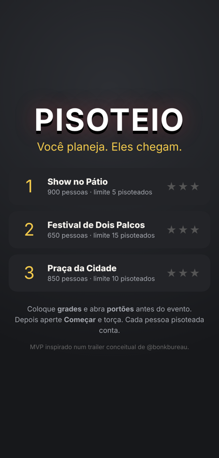
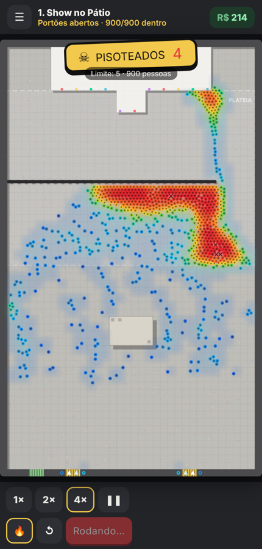

# ☠ PISOTEIO

**Você planeja. Eles chegam.**

Simulador de gestão de multidões que roda no navegador. Antes do evento você coloca grades e abre portões. Depois centenas de pessoas entram, se espremem na frente do palco e tentam sair todas ao mesmo tempo. Se o espaço não aguentar, o contador **PISOTEADOS** sobe.

### ▶ [Jogar agora](https://gabrielseibel.github.io/pisoteio/)

| Menu | Planejamento | Evento |
|---|---|---|
|  |  |  |

## Como jogar
1. Escolha uma fase e leia o briefing (número de pessoas e limite de pisoteados).
2. **Planeje:** toque e arraste no mapa para colocar **grades** (R$ 4/m) ou abrir **portões** no muro (R$ 45/m). Os rastros coloridos mostram por onde o público vai passar.
3. Aperte **▶ Começar** e acompanhe o **mapa de calor**: azul é tranquilo, vermelho é perigo.
4. Termine o evento com até o limite de pisoteados para ganhar de 1 a 3 estrelas.

Dicas: setorize a plateia com grades, garanta portões suficientes e evite fluxos que se cruzam.

## Fases do MVP
1. **Show no Pátio**: dois portões estreitos e 900 pessoas.
2. **Festival de Dois Palcos**: o público inteiro atravessa o campo no meio do evento.
3. **Praça da Cidade**: as ruas convergem para o palco central, sem poder abrir portões.

## Rodar localmente
```bash
python3 -m http.server 8000
# abra http://localhost:8000
node tests/headless.mjs   # calibração das fases sem interface
```

## Documentação
- [`docs/PROJETO.md`](docs/PROJETO.md): GDD completo, modelo de simulação, quadros de referência e roteiro.
- [`CLAUDE.md`](CLAUDE.md): instruções para continuar o desenvolvimento com o Claude Code.

## Créditos
Inspirado num trailer conceitual de um jogo que não existe, publicado por [@bonkbureau](https://www.instagram.com/reel/DeCabO7Rv3s/). Código e arte deste MVP são originais.
