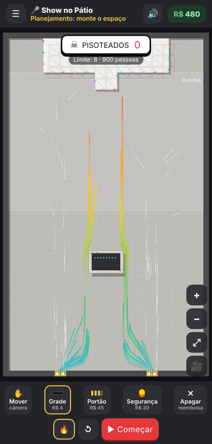
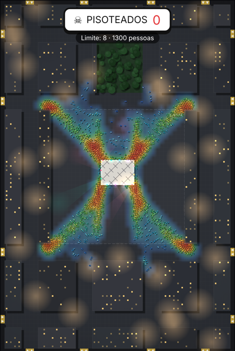
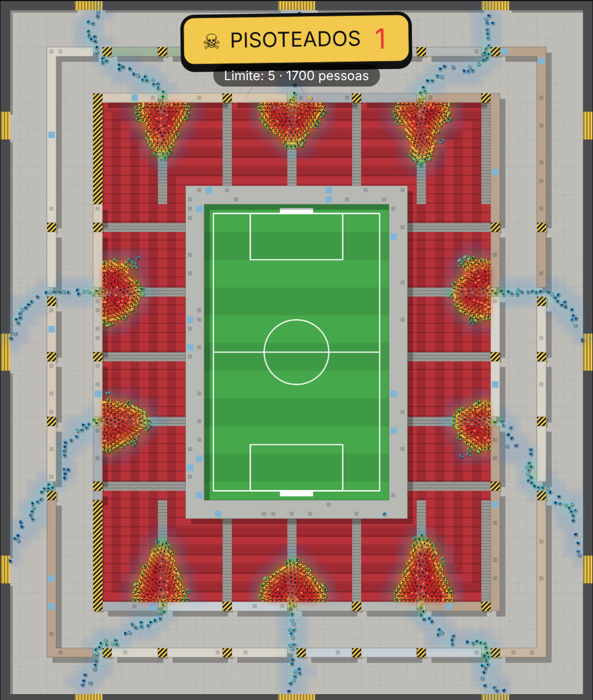
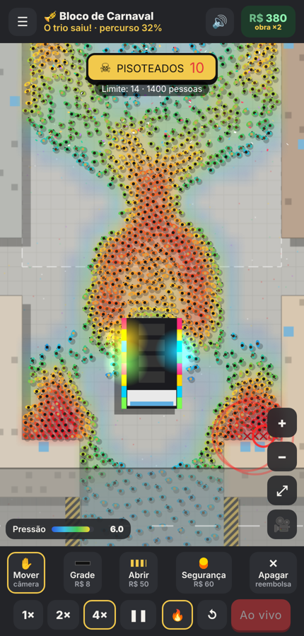

# ☠ PISOTEIO

**Você planeja. Eles chegam.**

Simulador de gestão de multidões que roda no navegador. Antes do evento você coloca grades e abre portões. Depois centenas de pessoas entram, se espremem na frente do palco e tentam sair todas ao mesmo tempo. Se o espaço não aguentar, o contador **PISOTEADOS** sobe.

### ▶ [Jogar agora](https://gabrielseibel.github.io/pisoteio/)

| Menu | Planejamento | Show ao vivo (zoom) |
|---|---|---|
|  |  |  |

| Réveillon à noite | Estádio | Carnaval (zoom no viaduto) |
|---|---|---|
|  |  |  |

## Como jogar
1. Escolha um evento e leia o briefing (número de pessoas e limite de pisoteados).
2. **Planeje:** toque e arraste no mapa para colocar **grades**, abrir **portões** e passagens fechadas (listras amarelas e pretas) e posicionar **seguranças**, que acalmam quem está por perto. Os rastros coloridos mostram por onde o público vai passar.
3. Aperte **▶ Começar**. Durante o evento você ainda pode fazer obras de emergência, pagando o dobro.
4. Acompanhe o **mapa de calor** e o medidor de **pressão**. Pinça ou roda do mouse dá zoom; 🎥 segue o ponto mais apertado.
5. Termine com até o limite de pisoteados para ganhar de 1 a 3 estrelas. O resultado mostra um gráfico de quando a pressão subiu.

## O que a simulação faz
- Rotas que desviam de aglomeração, empurra-empurra e quedas quando a densidade passa de ~5 pessoas/m².
- **Ondas de euforia** nos "drops" do show, **pânico contagioso** depois de cada queda, **seguranças** que acalmam.
- Arquibancadas, escadas e grama deixam as pessoas mais lentas.
- Trio elétrico que anda e arrasta a multidão; trens que chegam em sequência.

## Fases
1. 🎤 **Show no Pátio**: dois portões estreitos e 900 pessoas.
2. 🎪 **Festival de Dois Palcos**: o público inteiro atravessa o campo.
3. 🎆 **Réveillon na Praça**: oito ruas convergindo, à noite, com fogos.
4. ⚽ **Clássico no Estádio**: mosaico da torcida e saída pelos vomitórios.
5. 🎺 **Bloco de Carnaval**: o trio desce a avenida e passa sob um viaduto.
6. 🚇 **Estação na Hora do Rush**: cinco trens lotados em sequência.

## Rodar localmente
```bash
python3 -m http.server 8000
# abra http://localhost:8000
node tests/headless.mjs   # calibração das fases sem interface
```

## Documentação
- [`docs/PROJETO.md`](docs/PROJETO.md): GDD completo, modelo de simulação, quadros de referência e roteiro.
- [`CLAUDE.md`](CLAUDE.md): instruções para continuar o desenvolvimento com o Claude Code.

## Créditos
Inspirado num trailer conceitual de um jogo que não existe, publicado por [@bonkbureau](https://www.instagram.com/reel/DeCabO7Rv3s/). Código e arte deste MVP são originais.
