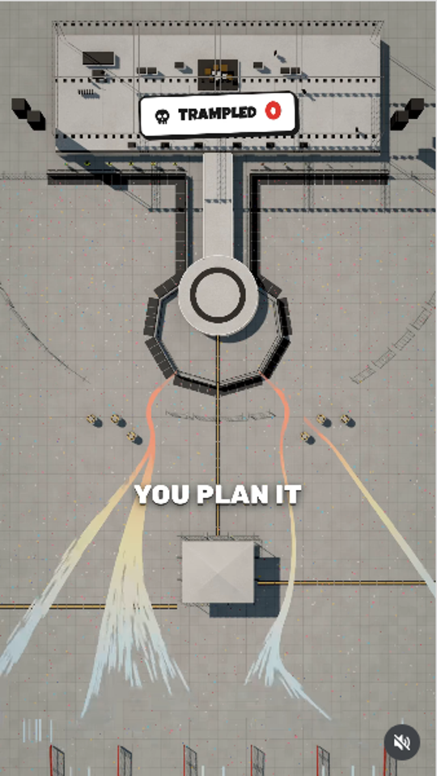
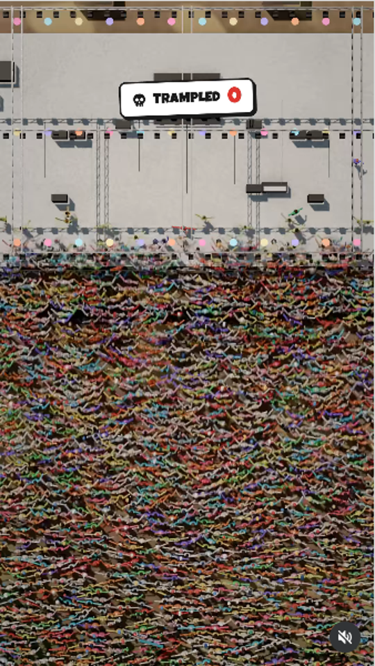
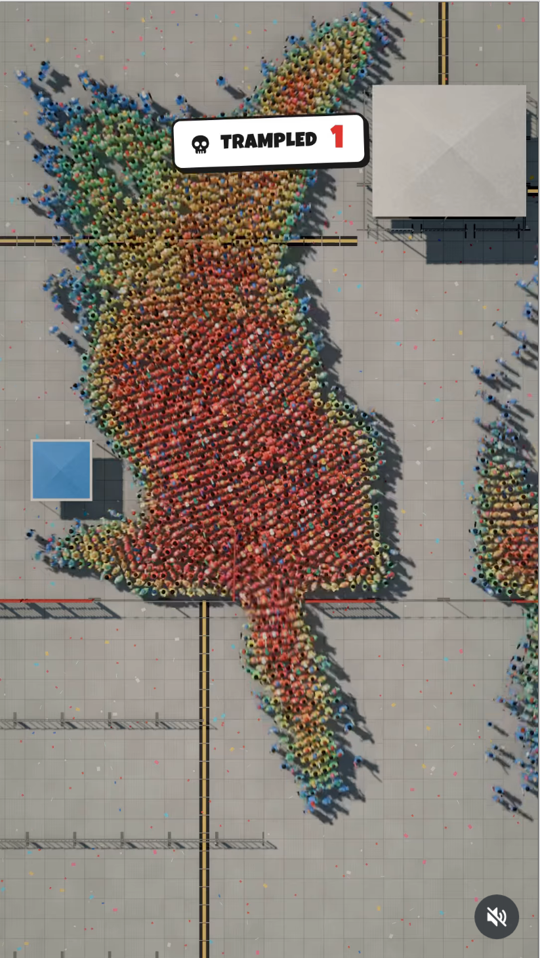
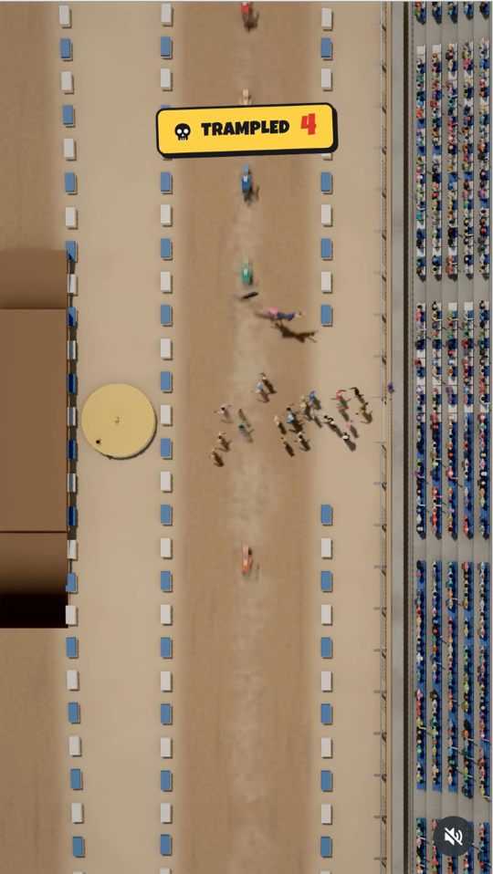
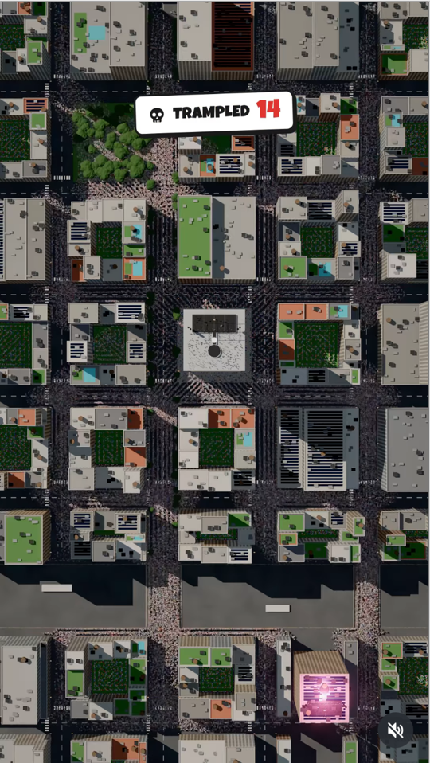
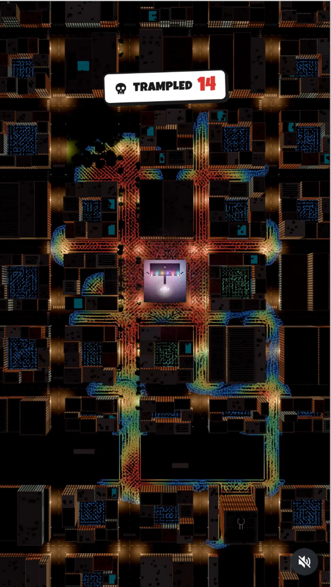

# PISOTEIO: documento de projeto (GDD + arquitetura)

> **Você planeja. Eles chegam.**
> Um simulador de gestão de multidões para navegador. O jogador não controla ninguém: ele desenha o espaço (grades, portões) e assiste a multidão reagir. A métrica de fracasso é o contador **PISOTEADOS**.

---

## 1. Origem da ideia

O jogo vem de um **trailer conceitual** publicado no Instagram por `@bonkbureau` (série *"making trailers for games i wish existed"*). O trailer mostra um jogo que **não existe**. Este projeto é uma interpretação própria, feita do zero.

- Link: https://www.instagram.com/reel/DeCabO7Rv3s/
- Legenda: citação de Charles Mackay (*Extraordinary Popular Delusions and the Madness of Crowds*, 1841). A ideia central é que os homens enlouquecem em bando e recuperam o juízo devagar, um por um.
- Hashtags de referência: Cities: Skylines, RollerCoaster Tycoon, Planet Zoo 2, Transport Fever 3, Crowd City.

### 1.1 Quadros de referência do trailer

Os prints abaixo estão em `docs/referencias/`. Use-os como **referência de clima e leitura visual**, não como arte para copiar.

| # | Quadro | O que observar |
|---|--------|----------------|
| 01 |  | **"YOU PLAN IT"**. É a fase de planejamento: pátio cinza com grade de piso, palco com passarela circular, barreiras pretas. Os **rastros coloridos** saem dos portões e vão ao palco (azul claro → amarelo → laranja). Contador "TRAMPLED 0" num selo branco no topo. |
| 02 |  | Show lotado visto de cima. Milhares de pessoas, cada uma um ponto colorido. Treliças de luz no palco. |
| 03 |  | **Mapa de calor** da densidade: borda azul, depois verde, amarelo e núcleo vermelho. Um gargalo entre grades gera a primeira vítima ("TRAMPLED 1"). |
| 04 |  | Variação: pista de corrida (estilo Pamplona) com arquibancadas. O selo fica **amarelo** quando o contador sobe. |
| 05 |  | Escala de cidade: quarteirões com telhados variados, parque arborizado, praça central com palco. A multidão ocupa as ruas. |
| 06 |  | A mesma cidade **à noite**, só com o mapa de calor nas ruas (modo "análise"). |
| 07 |  | Estádio de futebol com **tifo** (mosaico formado pela torcida). Possível modo futuro. |

---

## 2. Pilares de design

1. **Planejar, não controlar.** Todo o poder do jogador está no espaço. Durante o evento ele só assiste (e acelera ou pausa).
2. **Comportamento emergente.** Ninguém programa "aqui alguém morre". O pisoteio surge da física simples de muita gente querendo ir para o mesmo lugar.
3. **Leitura instantânea.** Azul é seguro e vermelho é perigo. Um X vermelho no chão é uma vítima. Qualquer pessoa entende o mapa de calor sem tutorial.
4. **Humor seco, tema sério.** O tom é o do trailer: o contador em selo de cartoon contrasta com a gravidade do tema. O jogo **não** mostra violência gráfica, só um X e um anel vermelho.

---

## 3. Loop de jogo (MVP)

```
MENU → BRIEFING → PLANEJAMENTO → SIMULAÇÃO → RESULTADO
                       ↑                        │
                       └──── Replanejar ────────┘
```

1. **Briefing:** a fase apresenta o evento, o número de pessoas, o limite de pisoteados e uma dica.
2. **Planejamento ("VOCÊ PLANEJA"):** com o orçamento (R$), o jogador:
   - coloca **grades** em células de chão (barreira preta);
   - abre **portões** em células do muro externo (saída extra);
   - **apaga** o que colocou (reembolso total).
   Rastros animados mostram por onde o público vai passar (prévia do fluxo).
3. **Simulação ("ELES CHEGAM"):** o evento roda em fases (`enter` → `hold` → `move` → `exit`). Velocidade de 1×, 2× ou 4×, com pausa. O mapa de calor pode ser ligado e desligado.
4. **Resultado:** estrelas conforme os pisoteados:
   - ★★★ = 0 pisoteados
   - ★★ = até metade do limite
   - ★ = até o limite
   - acima do limite = "Tragédia" (replanejar)

### 3.1 Fases do MVP

| # | Fase | Pessoas | Limite | Desafio principal | Referência |
|---|------|---------|--------|-------------------|------------|
| 1 | Show no Pátio | 900 | 5 | Dois portões estreitos e evacuação em massa | quadros 01–03 |
| 2 | Festival de Dois Palcos | 650 | 15 | Travessia do campo entre palcos e barracas | — |
| 3 | Praça da Cidade | 850 | 12 | 14 ruas convergindo; não pode abrir portões | quadros 05–06 |

Calibração atual (sem nenhuma construção do jogador → com um plano razoável, ver `tests/headless.mjs`):

- Fase 1: ~7–11 → 2
- Fase 2: ~56 → 5
- Fase 3: ~16 → 11

---

## 4. Simulação (o coração do jogo)

Arquivo: `js/sim.js`. **Não acessa DOM**, então roda igual no navegador e no Node.

### 4.1 Mundo
- Grade de células de **1 m × 1 m** (mapas de 36 × 60, em formato retrato como o vídeo).
- Tipos de célula (`TILE`): `FLOOR`, `WALL` (muro do perímetro), `BUILDING`, `STAGE`, `FENCE` (do jogador), `GATE`.
- `zone[i]`: índice da plateia (−1 = nenhuma). `spawn[i]`: portão por onde o público entra.

### 4.2 Rotas: campo de fluxo (flow field)
- **Dijkstra** a partir das células-alvo (plateia da fase atual, ou portões na evacuação), com 8 vizinhos e sem cortar quinas.
- **Custo de congestionamento:** cada célula custa `1 + congestionCost × densidade`. O campo é recalculado a cada 1 s, então as pessoas desviam de aglomerações.
- Cada pessoa lê a direção do campo com interpolação bilinear, para o movimento ficar suave.
- Um segundo campo, `stageField`, aponta para a borda do palco. Quem já está na plateia avança para a frente enquanto houver espaço.

### 4.3 Pessoas (agentes)
Estrutura de arrays (`Float32Array`) para desempenho: `x, y, vx, vy, v0, stress, state`.

Cada passo (`dt = 1/30 s`):
1. **Vontade:** direção do campo × velocidade desejada (`v0 ≈ 1,3 m/s`).
2. **Diagrama fundamental:** a velocidade cai com a densidade *à frente* (`1 − ρ/ρ_jam`). A **urgência** (pressa na evacuação, euforia no show) aumenta `ρ_jam`, então as pessoas empurram mesmo no aperto.
3. **Empurra-empurra:** dinâmica baseada em posição "macia" (`pushK < 1`, 3 iterações). Isso permite *compressão*, e a compressão é o que mata.
4. **Paredes e grades:** colisão círculo × AABB das células sólidas.
5. **Pressão:** densidade local (média 3×3 ponderada, em pessoas/m²). Acima de `dangerDensity ≈ 5,2 p/m²` acumula `stress`. Com `stress > 1,6` a pessoa **cai** e o contador sobe.
6. **Efeito cascata:** quem cai vira um corpo no chão (obstáculo com raio maior e peso 1,6 na densidade). Isso piora a região, como acontece em tragédias reais.

### 4.4 Fases do evento (`level.phases`)
| `kind` | O que acontece | Termina quando |
|--------|----------------|----------------|
| `enter` | Público nasce nos portões `spawn` (fila se o portão lotar) e vai para `zone` | todos entraram e ≥ 92% estão na zona, ou `maxTime` |
| `hold` | Show: a plateia empurra rumo ao palco (`excitement`) | `duration` |
| `move` | Todos migram para outra zona | ≥ 92% chegaram, ou `maxTime` |
| `exit` | Evacuação por **todos** os portões, com mais pressa | todos saíram, 20 s sem ninguém sair, ou `maxTime` |

### 4.5 Parâmetros (`PARAMS` em `sim.js`, sobrescrevíveis por fase em `level.params`)
`radius, speed, relax, pushK, dangerDensity, stressToFall, stressRecover, congestionCost, standDensity, jamDensity, exitUrgency, spawnMaxDensity`.

> **Regra de ouro:** toda mudança de parâmetro precisa rodar `node tests/headless.mjs`. A fase sem plano deve **falhar** e o plano de referência deve **passar**.

---

## 5. Visual e interface

Arquivo: `js/render.js` (Canvas 2D) e `css/style.css`.

- **Câmera fixa de cima**, mapa ajustado à tela, nítido em telas retina (`devicePixelRatio`).
- **Camada estática** (redesenhada só quando o mapa muda): concreto com grade e confetes, sombras deslocadas para dar volume, telhados com cores por bloco, árvores, luzes do palco, portões listrados, grades pretas que se conectam.
- **Camada dinâmica:** mapa de calor suave (`ImageData` W×H ampliada com suavização), pessoas como círculos com "cabeça" escura, cor por densidade (com calor ligado) ou camiseta aleatória (com calor desligado). Vítima = X vinho e anel vermelho que expande. A tela treme quando alguém cai.
- **Prévia de fluxo** no planejamento: partículas com rastro em leque. As de entrada vão dos portões ao palco (gradiente azul → laranja); as de saída, brancas, vão da plateia aos portões.
- **Selo PISOTEADOS:** branco → amarelo (dentro do limite) → vermelho (estourou). Tem animação de "pulo" a cada vítima.
- **Banners** grandes no centro: "VOCÊ PLANEJA", "ELES CHEGAM", nome de cada fase.
- **Mobile first:** controles por toque (Pointer Events), barra inferior com botões grandes e `safe-area-inset`.
- Fontes: *Lilita One* (títulos, selo) e *Inter* (interface).

Atalhos: `Espaço` começa ou pausa · `1/2/3` escolhem a ferramenta · `H` liga o calor · botão direito apaga.

---

## 6. Estrutura do repositório

```
pisoteio/
├── index.html          # telas: menu, jogo, modal
├── css/style.css
├── js/
│   ├── sim.js          # simulação pura (World, FlowField, Simulation)
│   ├── levels.js       # fases geradas por código
│   ├── render.js       # Canvas 2D
│   └── main.js         # estados, entrada, laço, HUD
├── tests/headless.mjs  # calibração sem interface (Node 18+)
├── docs/
│   ├── PROJETO.md      # este documento
│   ├── referencias/    # quadros do trailer
│   └── mvp/            # prints do MVP
├── CLAUDE.md           # instruções para o Claude Code
└── README.md
```

Sem build e sem dependências: ES Modules puros, servidos direto pelo GitHub Pages.

---

## 7. Roteiro (pós-MVP)

**Próximo passo (v0.2)**
- [ ] Editar **durante** o evento, pagando o dobro (decisões sob pressão).
- [ ] Novas ferramentas: *segurança/orientador* (empurra o fluxo numa direção), *corredor de mão única*, *telão* (atrai público para outra área), *placa de saída*.
- [ ] Gráfico de pisoteados × tempo na tela de resultado.
- [ ] Replay do evento com câmera lenta nos momentos críticos.

**v0.3**
- [ ] Fase **Corrida na Pista** (quadro 04): touros/corredores atravessando, com público nas arquibancadas.
- [ ] Fase **Estádio** (quadro 07): esvaziamento depois do jogo, por anéis e rampas.
- [ ] Modo noite / "análise" (quadro 06): só o mapa de calor sobre o mapa escuro.
- [ ] Editor de fases e compartilhamento por URL (mapa codificado em base64).

**v1.0**
- [ ] WebGL/instancing para 5.000+ pessoas.
- [ ] Simulação num Web Worker.
- [ ] Trilha e efeitos sonoros (murmúrio da multidão que sobe com a densidade).
- [ ] Ranking por fase (menos pisoteados com menor custo).

---

## 8. Cuidados com o tema

Pisoteamentos são tragédias reais (Love Parade 2010, Itaewon 2022). O jogo trata o tema como **engenharia de segurança**: entender densidade, gargalos e rotas de fuga. Por isso:
- não há sangue nem corpos detalhados, só marcadores abstratos;
- a tela de "Tragédia" orienta a replanejar, sem comemorar o fracasso;
- a dica de cada fase ensina um princípio real de gestão de multidões (setorização, portões suficientes, fluxos que não se cruzam, mão única).
