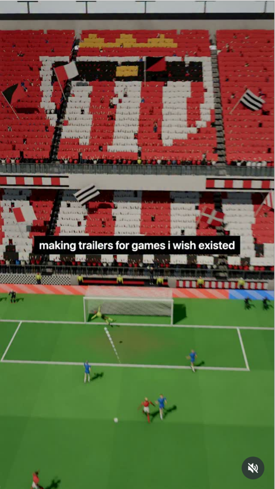

# PISOTEIO: documento de projeto (GDD + arquitetura)

> **Você planeja. Eles chegam.**
> Um simulador de gestão de multidões para navegador. O jogador não controla ninguém: ele desenha o espaço (grades, portões, seguranças) e assiste a multidão reagir. A métrica de fracasso é o contador **PISOTEADOS**.

---

## 1. Origem da ideia

O jogo vem de um **trailer conceitual** publicado no Instagram por `@bonkbureau` (série *"making trailers for games i wish existed"*). O trailer mostra um jogo que **não existe**. Este projeto é uma interpretação própria, feita do zero.

- Link: https://www.instagram.com/reel/DeCabO7Rv3s/
- Legenda: citação de Charles Mackay (*Extraordinary Popular Delusions and the Madness of Crowds*, 1841). A ideia central é que os homens enlouquecem em bando e recuperam o juízo devagar, um por um.
- Hashtags de referência: Cities: Skylines, RollerCoaster Tycoon, Planet Zoo 2, Transport Fever 3, Crowd City.

### 1.1 Quadros de referência do trailer

Os prints abaixo estão em `docs/referencias/`. Use-os como **referência de clima e leitura visual**, não como arte para copiar.

| # | Quadro | O que observar |
|---|--------|----------------|
| 01 |  | **"YOU PLAN IT"**. É a fase de planejamento: pátio cinza com grade de piso, palco com passarela circular, barreiras pretas. Os **rastros coloridos** saem dos portões e vão ao palco (azul claro → amarelo → laranja). Contador "TRAMPLED 0" num selo branco no topo. |
| 02 |  | Show lotado visto de cima. Milhares de pessoas, cada uma um ponto colorido. Treliças de luz no palco. |
| 03 |  | **Mapa de calor** da densidade: borda azul, depois verde, amarelo e núcleo vermelho. Um gargalo entre grades gera a primeira vítima ("TRAMPLED 1"). |
| 04 |  | Variação: pista de corrida (estilo Pamplona) com arquibancadas. O selo fica **amarelo** quando o contador sobe. |
| 05 |  | Escala de cidade: quarteirões com telhados variados, parque arborizado, praça central com palco. A multidão ocupa as ruas. |
| 06 |  | A mesma cidade **à noite**, só com o mapa de calor nas ruas (modo "análise"). |
| 07 |  | Estádio de futebol com **tifo** (mosaico formado pela torcida). Virou a fase **Clássico no Estádio** (mosaico animado na arquibancada). |

---

## 2. Pilares de design

1. **Planejar, não controlar.** Todo o poder do jogador está no espaço. Durante o evento ninguém obedece a cliques: o jogador só pode fazer **obras de emergência** (pagando o dobro) e reposicionar a câmera.
2. **Comportamento emergente.** Ninguém programa "aqui alguém morre". O pisoteio surge de regras simples: muita gente indo para o mesmo lugar, ondas de euforia, pânico que se espalha depois de uma queda.
3. **Leitura instantânea.** Azul é seguro e vermelho é perigo. Um anel vermelho em volta de alguém avisa que a pessoa está quase caindo. Um X é uma vítima.
4. **Humor seco, tema sério.** O selo de cartoon contrasta com a gravidade do tema. Não há violência gráfica.

---

## 3. Loop de jogo

```
MENU → BRIEFING → PLANEJAMENTO → EVENTO AO VIVO → RESULTADO (estrelas + gráfico)
                       ↑        (obras de emergência ×2)      │
                       └────────────── Replanejar ────────────┘
```

### 3.1 Ferramentas
| Ferramenta | O que faz | Custo típico |
|---|---|---|
| ✋ Mover | Arrasta a câmera (também: dois dedos, botão do meio) | — |
| Grade | Barreira de 1 m sobre chão ou grama. Divide setores, cria corredores e mão única | R$ 4 |
| Portão / Abrir | Abre um portão no muro externo **ou** uma passagem fechada (listras amarelas e pretas: vomitório, catraca, escada interditada, tapume) | R$ 25–45 |
| Segurança | Raio de 5 m: reduz o ganho de estresse, a euforia e faz o pânico passar mais rápido | R$ 30 |
| Apagar | Remove e reembolsa o valor-base (botão direito também apaga) | — |

Durante o evento todos os custos dobram (selo **obra ×2**) e as rotas são recalculadas na hora.

### 3.2 Câmera
- Pinça (celular), roda do mouse ou pinça do trackpad: zoom de "ver tudo" até ~60 px/m.
- Botões **+ / − / ⤢**.
- 🎥 **Câmera do perigo**: segue suavemente o ponto mais apertado da multidão, como as tomadas do trailer.
- Abertura cinematográfica: cada fase começa perto do palco (ou do trio) e afasta até mostrar o mapa.

### 3.3 Fases
| # | Fase | Pessoas | Limite | Mecânica central | Referência |
|---|------|---------|--------|------------------|------------|
| 1 | 🎤 Show no Pátio | 900 | 8 | Portões estreitos, ondas de euforia contra a grade da passarela | quadros 01–03 |
| 2 | 🎪 Festival de Dois Palcos | 650 | 22 | Toda a multidão atravessa o campo entre barracas | — |
| 3 | 🎆 Réveillon na Praça (noite) | 1300 | 8 | Oito ruas convergindo; sem portões; contagem regressiva com fogos | quadros 05–06 |
| 4 | ⚽ Clássico no Estádio | 1700 | 5 | Torcida já sentada; mosaico; saída por vomitórios e portões | quadro 07 |
| 5 | 🎺 Bloco de Carnaval | 1400 | 14 | Trio elétrico em movimento arrasta a multidão; viaduto estreita a avenida | — |
| 6 | 🚇 Estação na Hora do Rush | 1150 | 5 | Cinco trens despejam passageiros em sequência; escadas e catracas | — |

Calibração (semente 7, `node tests/headless.mjs`), sem plano → com plano de referência:

| Fase | Sem plano | Com plano |
|---|---|---|
| Pátio | 16 | 4 (sementes 1–3: 5–8) |
| Festival | 33 | 21 |
| Réveillon | 10 | 6 |
| Estádio | 10 | 0 |
| Carnaval | 32 | 11 |
| Metrô | 11 | 0 |

### 3.4 Resultado
- ★★★ = 0 pisoteados · ★★ = até metade do limite · ★ = até o limite · acima = "Tragédia".
- Gráfico de **pressão máxima (p/m²)** e **pisoteados** ao longo do tempo, com a faixa de perigo marcada, para o jogador entender *quando* o espaço falhou.

---

## 4. Simulação (o coração do jogo)

Arquivo: `js/sim.js`. **Não acessa DOM**, então roda igual no navegador e no Node.

### 4.1 Mundo
- Grade de células de **1 m × 1 m**. Os mapas vão de 36 × 60 a 64 × 76.
- Tipos (`TILE`): `FLOOR`, `WALL`, `BUILDING`, `STAGE`, `FENCE`, `GATE`, `SEATS` (arquibancada: 42% da velocidade, custo 2,4), `GRASS` (85%), `STAIRS` (62%), `PITCH` e `TRACK` (isolados).
- `zone[i]`: plateia. `spawn[i]`: portão de entrada. `openable[i]`: parede que o jogador pode abrir. `doors`: portas do trem.
- `World.version` aumenta a cada edição; a simulação e o renderizador reagem na hora (edição em tempo real).

### 4.2 Rotas: campo de fluxo
- **Dijkstra** a partir das células-alvo, 8 vizinhos, sem cortar quinas.
- Custo = distância × custo do piso × (1 + `congestionCost` × densidade). Recalculado a cada 1 s (0,5 s durante o desfile), então a multidão desvia de aglomerações.
- `stageField` aponta para a borda do palco ou, sem palco, para o trio elétrico.

### 4.3 Pessoas
Arrays tipados: `x, y, vx, vy, v0, stress, panic, fx, fy, heading, walk, shirt, state`.

A cada passo (1/30 s):
1. **Vontade:** direção do campo × velocidade desejada × velocidade do piso.
2. **Plateia:** quem chegou avança rumo ao palco enquanto a densidade estiver abaixo de `standDensity × euforia`. Na arquibancada, fica sentado.
3. **Diagrama fundamental:** a velocidade cai com a densidade à frente. Pressa (evacuação), euforia e pânico aumentam o quanto a pessoa empurra.
4. **Empurra-empurra macio** (3 iterações) e colisão com paredes, grades e o trio.
5. **Pressão:** acima de 5,2 p/m², acumula `stress`. Passou de 1,6, **cai**.
6. **Cascata:** o corpo no chão vira obstáculo e ocupa mais espaço na densidade.

### 4.4 Comportamentos novos (v0.2)
| Comportamento | Como funciona | Parâmetros |
|---|---|---|
| **Ondas de euforia** | A cada 7 s de show, 2,2 s de "drop": a euforia sobe +0,4 e a plateia empurra para o palco. As pessoas pulam e levantam os braços | `surgeEvery`, `surgeLength`, `surgeBoost` |
| **Pânico contagioso** | Cada queda assusta quem está a até 4,5 m: a pessoa foge na direção oposta e empurra mais por alguns segundos. Isso cria as ondas de choque das tragédias reais | `panicRadius`, `panicGain`, `panicDecay`, `panicPush` |
| **Seguranças** | Mapa `calm` (0–1) com raio de 5 m. Reduz estresse, euforia e contágio; o pânico some até 7× mais rápido | `staffRadius`, `staffCalm` |
| **Trio elétrico** | Atrator que anda por um percurso. Quem está logo à frente abre para os lados; quem está mais à frente espera; a "pipoca" se aperta em volta; o trio **para** se a frente estiver lotada | `level.parade` |
| **Trens** | Fases `burst`: N passageiros desembarcam pelas portas em X s; o próximo trem chega mesmo se a plataforma não esvaziou | `count`, `unload`, `interval` |
| **Câmera do perigo** | `sim.hot` guarda o ponto de maior densidade, suavizado | — |
| **Histórico** | A cada 1 s grava pisoteados e pico de densidade para o gráfico | `sim.history` |

### 4.5 Fases do evento (`level.phases`)
| `kind` | O que acontece | Termina quando |
|--------|----------------|----------------|
| `enter` | Público nasce nos portões `spawn` e vai para a `zone` | todos entraram e ≥ 92% estão na zona, ou `maxTime` |
| `fill` | Coloca todo o público já sentado na zona (estádio) | imediato |
| `hold` | Show/jogo/contagem (`show`: `concert`, `countdown`, `match`) com ondas de euforia | `duration` |
| `move` | Todos migram para outra zona | ≥ 92% chegaram, ou `maxTime` |
| `follow` | O trio percorre `parade.path` e a multidão vai junto | o trio chega ao fim |
| `burst` | Um trem desembarca `count` pessoas pelas `doors` | depois de `interval` s |
| `exit` | Evacuação por todos os portões | todos saíram, 20 s sem ninguém sair, ou `maxTime` |

> **Regra de ouro:** toda mudança de parâmetro precisa rodar `node tests/headless.mjs` (com e sem plano). A fase sem plano deve **falhar** e o plano de referência deve **passar**.

---

## 5. Visual, som e interface

Arquivos: `js/render.js`, `js/audio.js`, `css/style.css`.

- **Câmera** em metros: tudo é desenhado com uma transformação (`cam.x, cam.y, cam.z`). A camada fixa é pré-renderizada a até 40 px/m (~6 Mpx no máximo).
- **Pessoas** com nível de detalhe: de longe são pontos coloridos; de perto ganham sombra, ombros orientados pela direção do movimento, cabeça com cor de cabelo, **pés que alternam ao andar**, pulo e braços para cima no show, e anel vermelho de alerta quando estão perto de cair. Só o que está na tela é desenhado.
- **Cores:** mapa de calor (padrão), camisetas variadas, abadás no carnaval e **mosaico** que ondula na arquibancada durante o jogo.
- **Efeitos por evento:** fachos e poças de luz coloridas do palco (mais fortes nos "drops"), confete caindo, fogos de artifício com clarão no réveillon, trio com luzes piscando, trem chegando e partindo, viaduto semitransparente por cima da multidão.
- **Noite:** prédios escuros com janelas acesas, postes com halo, mapa de calor brilhante (modo aditivo) e vinheta.
- **Som (Web Audio, sem arquivos):** murmúrio que cresce com a densidade, batida do show, gritos de euforia, apito do juiz, buzina do trem, estouros de fogos. Botão 🔊.
- **HUD:** selo PISOTEADOS (branco → amarelo → vermelho, com pulo e vibração no celular), medidor de **pressão** ao vivo, orçamento com aviso de obra ×2, banners de fase.
- Atalhos: `Espaço` começa/pausa · `0–4` ferramentas · `H` calor · `C` câmera do perigo · `+/−` zoom · botão direito apaga.

---

## 6. Estrutura do repositório

```
pisoteio/
├── index.html          # telas: menu, jogo, modal
├── css/style.css
├── js/
│   ├── sim.js          # simulação pura (World, FlowField, Simulation)
│   ├── levels.js       # 6 fases geradas por código
│   ├── render.js       # Canvas 2D com câmera e efeitos
│   ├── audio.js        # som ambiente procedural
│   └── main.js         # estados, entrada (toque/mouse), laço, HUD
├── tests/headless.mjs  # calibração sem interface + planos de referência
├── docs/
│   ├── PROJETO.md      # este documento
│   ├── referencias/    # quadros do trailer
│   └── mvp/            # prints do jogo
├── CLAUDE.md
└── README.md
```

---

## 7. Roteiro

**v0.2 (feito)**
- [x] Câmera com zoom, arrasto, pinça e câmera do perigo
- [x] Pessoas animadas, efeitos de show, confete, fogos, mosaico, modo noite
- [x] Ondas de euforia, pânico contagioso, seguranças, pisos lentos
- [x] Obras de emergência durante o evento (custo ×2)
- [x] Três cenários novos: estádio, carnaval, metrô
- [x] Gráfico no resultado e som ambiente

**v0.3**
- [ ] Fase **Corrida na Pista** (quadro 04), com corredores atravessando o público.
- [ ] Ferramentas: placa de saída (puxa o fluxo), telão (atrai público), corredor de mão única.
- [ ] Replay com câmera lenta no momento da primeira queda.
- [ ] Grupos de amigos que tentam ficar juntos (e voltam para buscar quem se perdeu).
- [ ] Editor de fases e compartilhamento por URL.

**v1.0**
- [ ] WebGL/instancing para 5.000+ pessoas; simulação num Web Worker.
- [ ] Clima (chuva acelera a saída), dia → noite durante o evento.
- [ ] Ranking por fase (menos pisoteados com menor custo).

---

## 8. Cuidados com o tema

Pisoteamentos são tragédias reais (Love Parade 2010, Itaewon 2022). O jogo trata o tema como **engenharia de segurança**: entender densidade, gargalos, rotas de fuga e o papel da equipe. Por isso:
- não há sangue nem corpos detalhados, só marcadores abstratos; o som não tem gritos de dor;
- a tela de "Tragédia" mostra o gráfico e orienta a replanejar, sem comemorar o fracasso;
- a dica de cada fase ensina um princípio real de gestão de multidões (setorização, portões suficientes, fluxos que não se cruzam, mão única, equipe nos pontos de convergência).
